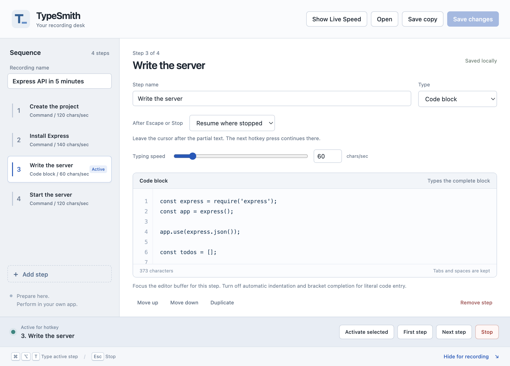

links: [repo](https://github.com/bradtraversy/typesmith)

[TypeSmith](/devlog/2026-04-13-typesmith-on-pypi) started as a Python CLI that
types commands into a terminal with human-looking timing, so recordings don't
look pasted. It now has a macOS side, merged into the repo this week as three
features:

- A global typing shortcut. Each press types the next line of a script into
  whatever text field has focus, in a terminal, an editor, a browser or a notes
  app, and it never presses Return for you. A `#mode block` script types a
  whole code block in one press, whitespace and all. Escape or a second press
  stops it.
- A control panel app for building a recording as ordered command and code
  steps, each with its own speed. You pick the active step, hide the panel and
  use the shortcut. After Escape it can restart the step or resume from the
  last confirmed character.
- Menu bar access and proper app icons.

*The control panel with a sample recording. The code block step is active for the shortcut.*

The app isn't in the PyPI package and won't be. PyPI keeps the cross-platform
CLI. The app is a Swift build that needs Accessibility permission, and today a
Karabiner rule for the shortcut, which a Python wheel can't reasonably ship. The
plan is a signed, notarized DMG: move the shortcut into the app so Karabiner
isn't needed, then Developer ID signing and notarization. Until then it's ad hoc
signed, so it won't open on other Macs and it loses its Accessibility permission
on every rebuild.

One bug came out of the cleanup. With unsaved edits, clicking a step tried to
save first, so an invalid step could trap the selection. Now a click just opens
the step, and saving makes it active.

The Mac app will be released soon as a signed download. Until then, you can build it from source on macOS.
